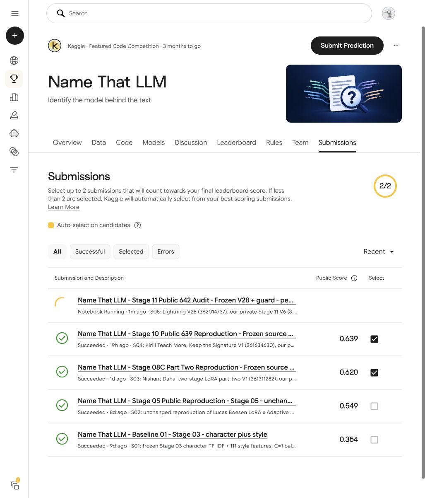

# Stage 11 — S05 submitted; official score pending

## Current verified outcome — 25 October 2026

Official **S05 is accepted and displays Notebook Running**, with **no displayed S05 score**. It uses our private **V6 362129392**, preserving all 33 source code cells of Lightning V28 **362014737** and adding only an independent output-validation cell. All 34 saved code-cell strings were read back from Kaggle's actual saved version and match the committed notebook. All 28 pinned input versions remain unchanged. The author's **0.642** is a lead, not our result; our confirmed best remains **S04 0.639 official public balanced accuracy**.

The real CPU audit passed **175/175 checks** in **686.1 seconds**. The separate real **Qwen-only GPU probe V3 362125549 succeeded in 418.9 seconds** on two Tesla T4 GPUs: 12 passages spanning token-length ranks, finite ordered 12-by-18 logits, correct native-to-canonical class alignment, and no timeout. Its whole child process group exited normally within the 900-second deadline. The 19.448 GB NF4 copy used `/tmp`; model loading took 111.8 seconds, and the four inference batches took 18.35 seconds. Peak reserved memory was about 7.18 GB per GPU. The probe evaluates execution only: the adapter saw all official labels, so no accuracy was computed. Complete reference/complement/ATLAS and hidden-test runtime remain unverified. See [actual probe](ACTUAL_QWEN_RUNTIME_PROBE.json) and [independent admission review](ACTUAL_QWEN_PROBE_INDEPENDENT_REVIEW.json).

Private production **V5 362128776** and final **V6 362129392** each succeeded in **21.7 seconds**, with **25/25 FORMAT ONLY checks**. The unchanged source recognizes the public three-row fixture and emits constant labels without loading the full models. These previews are not accuracy results or proof of hidden-test completion. The actual V6 log Accelerator heading shows the **GPU T4 x2 allocation profile** (direct two-device CUDA observation comes from the separate V3 probe), and the save dialog explicitly selected **Run with GPU for all sessions**. The notebook document's `isGpuEnabled` field remained false; that field is retained separately rather than presented as hardware evidence. See [final preview receipt](FORMAT_PREVIEW_V6.json).

S05 was submitted from that exact frozen V6. The official submissions row independently confirms **Notebook Running**. Its final result is pending, so no gain over S04 is claimed. The official page shows final selections **2/2**; this work did not change them. Only free Kaggle resources were used. No monitoring watch was created or enabled for S05.

[Official submissions](https://www.kaggle.com/competitions/name-that-llm/submissions) · [exact private candidate](https://www.kaggle.com/code/watchman777/name-that-llm-stage-11-public-642-audit?scriptVersionId=362129392) · [submission receipt](S05_SUBMISSION_RECEIPT.json) · [notebook/version index](NOTEBOOK_INDEX.md).

## Earlier CPU completion and probe admission checkpoint — 25 October 2026

Private CPU **V2 362119531 succeeded in 686.1 seconds**, with **175/175 audit checks passing**, including **160/160 mandatory source paths**. It verified 333 actual file hashes. All 17 active NF4 files, including seven large weight shards, were checked against the published QWEN38 addition manifest. The final adapter contains 144 tensors and 62 complete LoRA pairs; its native alphabetic label order is transported to the canonical ensemble order by the unchanged source's named permutation. No head, weight, metadata or source inference code was changed.

The complete saved report was 924,007 bytes, exceeding Kaggle's log and JSON-preview display limits. A separate CPU collector **362123509 succeeded in 57.7 seconds** and transported the exact saved bytes as gzip/base64. All 20 chunks, gzip SHA256 and raw-report SHA256 were verified. The full report's SHA256 is `aa39a49d561a11c4954de2fa7b0728b61d431a07332e5d28fc5fb8f29d2e9601`. See [readable aggregate summary](REAL_INPUT_AUDIT_V2_SUMMARY.json), [exact compressed report](REAL_INPUT_AUDIT_V2.json.gz), and [collection receipt](REPORT_COLLECTION_ACTUAL.json).

Independent review of the actual report admits the **bounded Qwen-only runtime probe**. The sole unresolved historical manifest entry refers to a tensor name in an unused mixed-FP8 asset tree; it is explicitly not counted as a verified file and does not affect the active NF4 root. Source byte pins, active schemas and actual NF4 payload checks remain separately verified. CPU `/tmp` had about 1.126 TB available, comfortably above the 19.448 GB staging copy plus 2 GiB reserve. This is CPU evidence; the GPU instance will measure its own space and environment.

The probe uses the five original worker modules unchanged, a real **900-second process-group deadline**, and 12 unlabeled token-length ranks. Only its admission literal has been populated from this verified CPU report. It has not launched at this checkpoint. CPU checks do not prove GPU execution or the complete hidden-test runtime. Our official best remains **S04 0.639**; no Stage 11 score exists.

The snapshots below retain earlier evidence and the corrected audit block.

## Earlier running checkpoint — 25 October 2026

The exact source V28 **362014737** (author public **0.642**) has been copied privately to watchman777. Our confirmed official best remains **S04 at 0.639**. The copy's UI mount for Name That LLM Artifacts is exactly `/kaggle/input/ntl-olmo2-native24-final-inference-assets/`.

The independently written CPU checker covers all **160 source-required paths**, **94 byte pins**, model/tokenizer and NF4 headers, complete adapter matrices, exact active prefit banks, safe numeric arrays, source metadata, offline wheels and manifest checksums. It imports no Torch/Transformers/custom inference modules and deserializes no joblib/pickle/Torch payloads. Synthetic failure tests and independent review passed before launch.

Actual private CPU **V1 362118178** found all 160 paths and passed the base, prefit, style, Night24, wheel, encoder and adapter inventories. Its Qwen native-label check was overstrict: the frozen source preserves native labels and explicitly reorders columns by name before blending. The checker was corrected to verify the canonical unique 18-label set and record that exact permutation; no inference source, weight or metadata changed. V1's code and receipts remain preserved.

Actual private CPU **V2 362119531** uses the corrected checker, with **37/37 synthetic checks** and an independent source-parity review. All 160 actual mandatory paths and the complete Qwen adapter check have passed. Both runs remain in manifest checksum reconciliation at this checkpoint; no overall real CPU pass is claimed yet.

A separate Qwen-only diagnostic is prepared and locked pending actual CPU V2 admission. It uses five byte-exact published worker modules, 12 unlabeled training passages selected across token-length ranks, isolated offline wheels and a **900-second process-group deadline**. Its 25 synthetic tests and independent review passed without loading a model. It will measure the new branch's execution and numerical checks only; the final adapter saw all official labels, so accuracy on these examples would not be validation. Complete hidden-test runtime will remain a separate limitation.

The live competition Code Requirements impose a **9-hour runtime limit for both CPU and GPU submissions**, with Internet disabled. The account enable dialog showed **29 free GPU hours remaining**; it was cancelled after reading. The editor displayed an original-environment pin, while the CPU viewer reports Latest Container Image; actual distribution metadata is being collected before any runtime-parity claim.

No GPU inference, training, new official submission, paid service or final-selection change has occurred in Stage 11.

[CPU V1](https://www.kaggle.com/code/watchman777/name-that-llm-stage-11-public-642-audit?scriptVersionId=362118178) · [CPU V2](https://www.kaggle.com/code/watchman777/name-that-llm-stage-11-public-642-audit?scriptVersionId=362119531) · [Prospective plan](PLAN.md).
