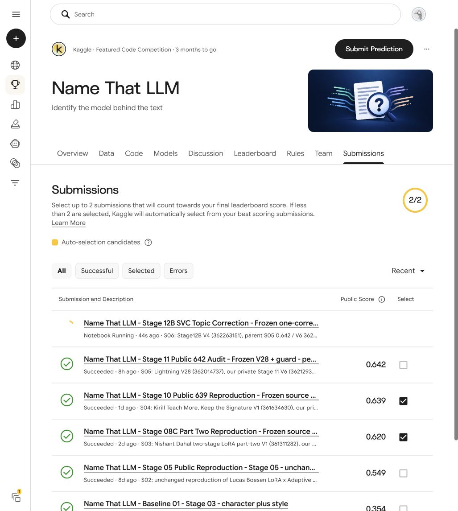

# Stage 12B — S06 accepted; official score pending

## Current verified outcome — 25 October 2026

Official **S06 is accepted and displays Notebook Running**, with no displayed S06 score. Exact private **V4 362263151** activates one existing SVC topic correction on our successful **S05 0.642** parent. Only original source cell30 changes; the other 32 original cells and parent guard34 remain exact, with a separate replay guard35 added. All 35 saved code cells and all 28 parent input versions match the reviewed pre-execution Git freeze **2c778522775d6b34e2efa387bee42fd420775c42**. No model, blend weight, grouping setting or final-selection change was made.

The preview succeeded in **20.3 seconds**, with the actual log allocation profile **GPU T4 x2** and persistent GPU save policy selected. All 25 parent format checks and 16 intervention-format checks pass. The new checks verify source hashes, placement and exactly one fixed call, but explicitly report **FORMAT_ONLY_PREVIEW_INTERVENTION_NOT_EXECUTED**: models and correction were not executed on the public three-row fixture. Hidden-run replay evidence, full-model output checks and official score remain pending. The legacy notebook-document GPU boolean is retained separately; no inference-device claim is derived from it.

The separate CPU component screen improved development balanced accuracy 37.8931% to 40.0425% (+2.1494 points), with conditional paired-prompt interval [+1.0380,+3.2593]. It passed the fixed screen and 37 independent terminal checks, but uses reused development folds and does not estimate a gain to the full ensemble. Production uncertainty gating uses the complete ensemble margin; its benefit is unknown. The declared policy permits this one blind official experiment with no automatic strength, placement or weight variants. Our confirmed best remains **S05 64.2% official public balanced accuracy**.

A read-only hourly result watch is enabled for S06 and will stop at its terminal outcome. Final selections remain S03/S04 (2/2), unchanged. Only free resources were used. The separate source-author 0.651 Stage12 route remains blocked by Meta Llama access; it is not this S06 job.

[Official submissions](https://www.kaggle.com/competitions/name-that-llm/submissions) · [exact private S06](https://www.kaggle.com/code/watchman777/name-that-llm-stage-12b-svc-topic-correction?scriptVersionId=362263151) · [submission receipt](S06_SUBMISSION_RECEIPT.json) · [format preview](FORMAT_PREVIEW_V4.json) · [saved-source parity](KAGGLE_SAVED_SOURCE_PARITY.json).

## Earlier prospective preparation checkpoint

# Stage12B — prepared fixed official counterfactual

The candidate is prepared for independent review and source freeze. No full model run, intervention activation or official score is established by this preparation.

Parent S05 is officially **0.642 public balanced accuracy**. This candidate activates one existing fixed SVC topic-correction call after the complete SVC/decoder/DeBERTa reference sum and before complementary mixing. Model weights, model worker code, all 28 input-version IDs and every downstream blend remain unchanged. Upstream orchestrator code cell30 deliberately changes; the other 32 source cells and original output guard34 are byte-for-byte preserved. Guard35 is separate.

The Stage12A component gain was **+2.149391 development percentage points**. Its SVC-only uncertainty gate differs from the complete-reference gate in this official candidate, and full-ensemble gains are unknown. One blind official test is predeclared; no automatic coefficient, threshold, placement or blend variants.

The new guard replays the correction once, reconstructs its complete reference input from saved SVC/decoder/DeBERTa scores, and verifies that the corrected total reaches the saved pre-ATLAS mixture. The inherited Stage11 guard remains unchanged and still contains its older statement that SVC logits are unavailable to its own checks. That limitation applies to the old guard's scope; the separate Stage12B evidence now supplies those margins to the new guard.

The source three-row preview bypasses models and the intervention. Its only valid intervention result is **FORMAT_ONLY_PREVIEW_INTERVENTION_NOT_EXECUTED**. Preparation's 16/16 synthetic checks and all-35-cell static compilation are not a hidden-test result.

See [protocol](PROTOCOL.md), [minimal source patch](SOURCE_PATCH.diff), [build receipt](BUILD_RECEIPT.json), and [synthetic validation](SYNTHETIC_VALIDATION.json).
